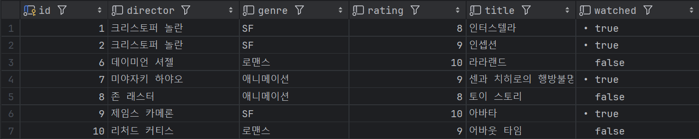
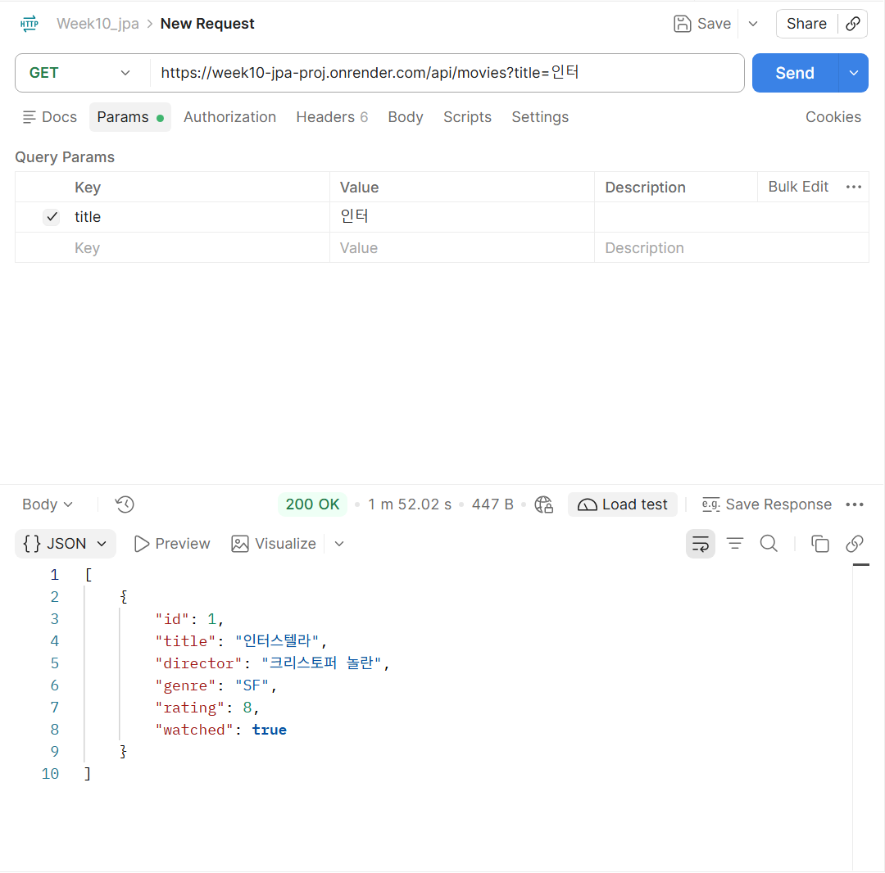
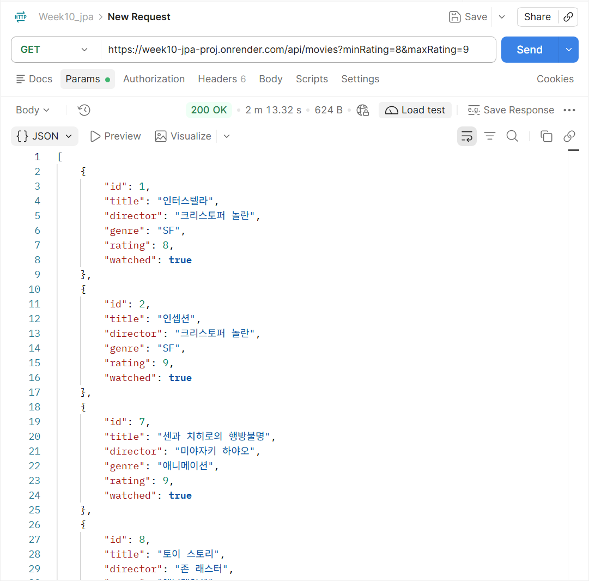
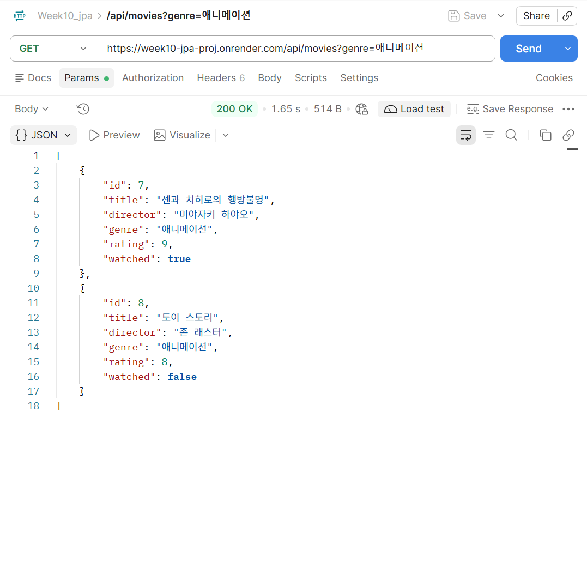

# ① 프로젝트 소개

## 프로젝트 주제 및 주요 기능

**Spring Data JPA 응용 및 기능 확장**

9주차에 개발한 Spring Boot 프로젝트를 기반으로 기존 JPA 코드를 분석합니다. 이를 기반으로 10주차 과제에서는 아래와 같은 기능을 구현합니다.
* Query Method를 활용한 검색·정렬
* Dirty Checking을 이용한 데이터 수정
* Auditing을 이용한 생성·수정 시간 자동 관리

## GitHub Repository URL
> https://github.com/2026-2-WebService/assign10-c01-22200252.git

## Render Deployment URL
> https://week10-jpa-proj.onrender.com

---

# ② 주요 구현 내용 및 결과

## Query Method 3개: 검색 조건 및 API 실행 결과
### `movies` 테이블


### 1. `List<Movie> findByTitleContainingIgnoreCase(String title);`
* 검색 조건: 제목에 검색어 포함, 대소문자 무시
* 테스트 URL: https://week10-jpa-proj.onrender.com/api/movies?title=인터
* API 실행 결과
  
  ```json
    [
        {
            "id": 1,
            "title": "인터스텔라",
            "director": "크리스토퍼 놀란",
            "genre": "SF",
            "rating": 8,
            "watched": true
        }
    ]
  ```

### 2. `List<Movie> findByRatingBetween(Integer minRating, Integer maxRating);`
* 검색 조건: 최소·최대 평점 사이
* 테스트 URL: https://week10-jpa-proj.onrender.com/api/movies?minRating=8&maxRating=9
* API 실행 결과
  
  ```json
  [
    {
        "id": 1,
        "title": "인터스텔라",
        "director": "크리스토퍼 놀란",
        "genre": "SF",
        "rating": 8,
        "watched": true
    },
    {
        "id": 2,
        "title": "인셉션",
        "director": "크리스토퍼 놀란",
        "genre": "SF",
        "rating": 9,
        "watched": true
    },
    {
        "id": 7,
        "title": "센과 치히로의 행방불명",
        "director": "미야자키 하야오",
        "genre": "애니메이션",
        "rating": 9,
        "watched": true
    },
    {
        "id": 8,
        "title": "토이 스토리",
        "director": "존 래스터",
        "genre": "애니메이션",
        "rating": 8,
        "watched": false
    },
    {
        "id": 10,
        "title": "어바웃 타임",
        "director": "리처드 커티스",
        "genre": "로맨스",
        "rating": 9,
        "watched": false
    }
  ]
  ```
### 3. `List<Movie> findByGenreOrderByRatingDesc(String genre);`
* 검색 조건: 장르 일치, 평점 내림차순
* 테스트 URL: https://week10-jpa-proj.onrender.com/api/movies?genre=애니메이션
* API 실행 결과
  
  ```json
  [
    {
        "id": 7,
        "title": "센과 치히로의 행방불명",
        "director": "미야자키 하야오",
        "genre": "애니메이션",
        "rating": 9,
        "watched": true
    },
    {
        "id": 8,
        "title": "토이 스토리",
        "director": "존 래스터",
        "genre": "애니메이션",
        "rating": 8,
        "watched": false
    }
  ]
  ```

## Dirty Checking: 수정 기능 구현 및 실행 결과
## Auditing: 생성·수정 시간 자동 기록 결과
※ 소스 코드에 작성한 설명이나 주석을 README에 중복 작성할 필요는 없습니다. 주요 기능의 실행 결과를 중심으로 정리하세요.

---

# ③ Weekly Review

## Key Learning: 새롭게 배운 내용 2~3가지
### Dirty Checking
### Auditing
### Transaction

### `isBlank()`와 `isEmpty`의 차이점
| 문자열 | `isEmpty()` | `isBlank()` |
|---|---:|---:|
| `""` | `true` | `true` |
| `"   "` | `false` | `true` |
| `"movie"` | `false` | `false` |

## Problem & Solution: 어려웠던 점과 해결 방법
## Reflection: 이번 과제를 통해 느낀 점

---

# ④ AI Usage

## 사용한 생성형 AI 도구 및 주요 질문

과제 수행 과정에서 ChatGPT의 도움을 받았습니다. 주로 코드 관련 개념 확립과 오류 검토에 활용하였으며 아래와 같이 질문하였습니다.

> 1. Query Method의 반환 타입으로 주로 `List<Movie>`를 사용하는 이유가 뭐야? 검색 결과의 개수나 용도에 따라 Query Method의 반환 타입을 다르게 지정할 수 있는지 설명해줘.
> 2. Spring Data JPA에서 Query Method를 작성하는 규칙과 주요 키워드의 사용법을 설명해줘.
> 3. `isBlank()`와 `isEmpty`의 차이점에 대해서 설명해줘.

## AI가 제공한 내용 중 직접 수정하거나 검증한 부분
쿼리 메소드를 서비스 단계에서 구현한 후 오류에 대해 검토하던 중 AI가 여러 개의 쿼리 조건이 한 번에 들어왔을 때를 대비하여 아래와 같은 코드를 추가할 것을 제안했습니다. 유효한 제안이라 생각되어 수락 후 아래 코드를 추가 작성하였습니다.

 ```bash
int conditionCount =
        (hasKeyword ? 1 : 0) +
        (hasRating ? 1 : 0) +
        (hasGenre ? 1 : 0);

if (conditionCount > 1) {
    throw new ResponseStatusException(
            HttpStatus.BAD_REQUEST,
            "검색 조건은 한 번에 하나씩 입력해 주세요."
    );
}
 ```

## AI 사용 비율에 대한 자기 평가