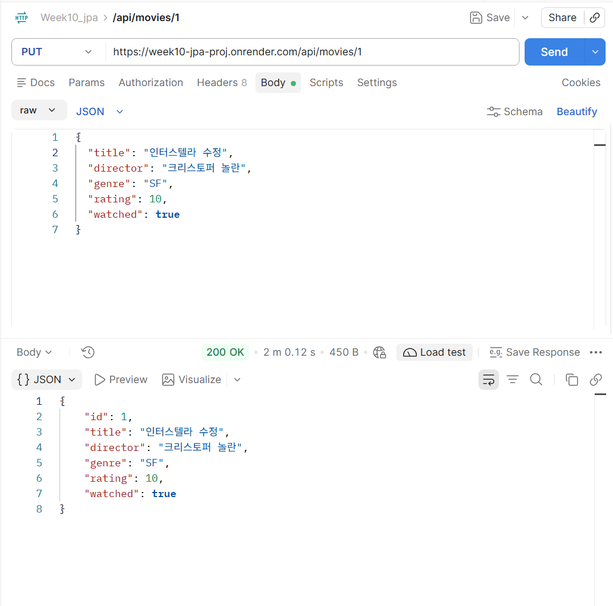
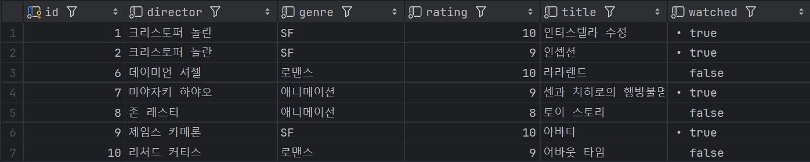
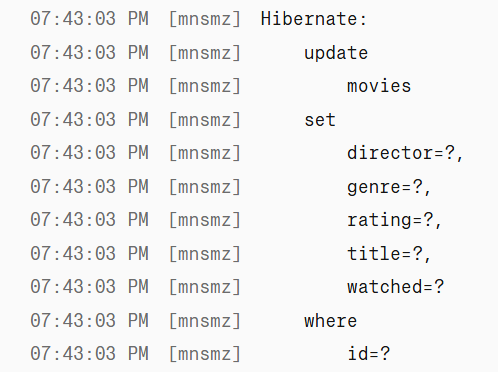
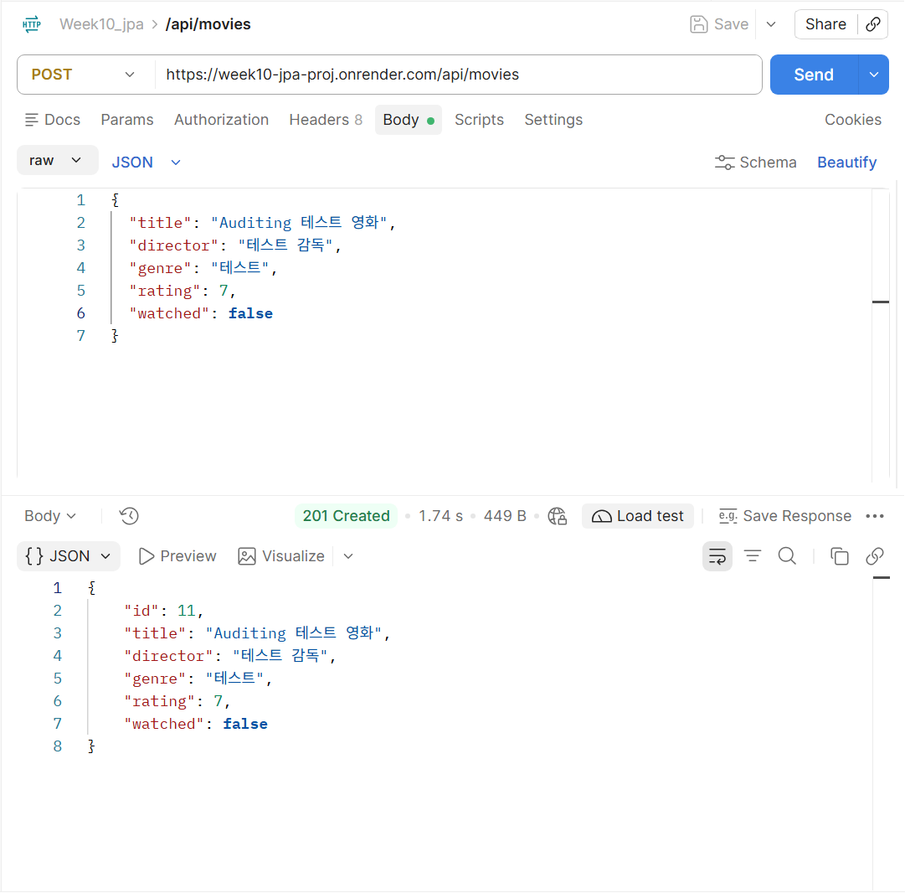
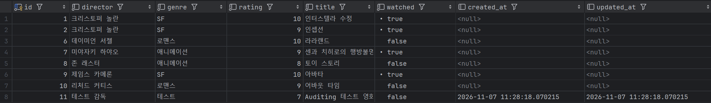
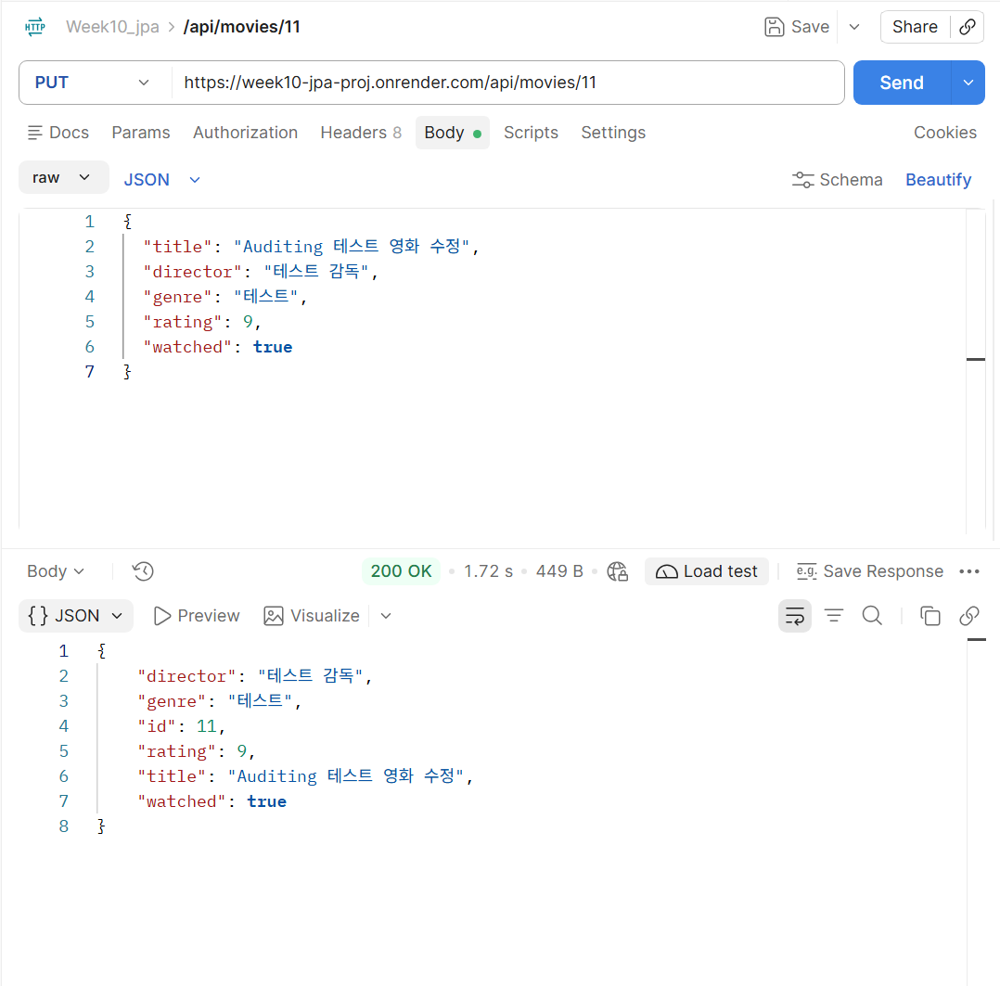

# ① 프로젝트 소개

## 프로젝트 주제 및 주요 기능

**Spring Data JPA 응용 및 기능 확장**

9주차에 개발한 Spring Boot 프로젝트를 기반으로 기존 JPA 코드를 분석합니다. 이를 기반으로 10주차 과제에서는 아래와 같은 기능을 구현합니다.
* Query Method를 활용한 검색·정렬
* Dirty Checking을 이용한 데이터 수정
* Auditing을 이용한 생성·수정 시간 자동 관리

## GitHub Repository URL
> https://github.com/2026-2-WebService/assign10-c01-22200252.git

## Render Deployment URL
> https://week10-jpa-proj.onrender.com

---

# ② 주요 구현 내용 및 결과

## Query Method 3개: 검색 조건 및 API 실행 결과
### `movies` 테이블


### 1. `List<Movie> findByTitleContainingIgnoreCase(String title);`
* 검색 조건: 제목에 검색어 포함, 대소문자 무시
* 테스트 URL: https://week10-jpa-proj.onrender.com/api/movies?title=인터
* API 실행 결과
  
  ```json
    [
        {
            "id": 1,
            "title": "인터스텔라",
            "director": "크리스토퍼 놀란",
            "genre": "SF",
            "rating": 8,
            "watched": true
        }
    ]
  ```

### 2. `List<Movie> findByRatingBetween(Integer minRating, Integer maxRating);`
* 검색 조건: 최소·최대 평점 사이
* 테스트 URL: https://week10-jpa-proj.onrender.com/api/movies?minRating=8&maxRating=9
* API 실행 결과
  
  ```json
  [
    {
        "id": 1,
        "title": "인터스텔라",
        "director": "크리스토퍼 놀란",
        "genre": "SF",
        "rating": 8,
        "watched": true
    },
    {
        "id": 2,
        "title": "인셉션",
        "director": "크리스토퍼 놀란",
        "genre": "SF",
        "rating": 9,
        "watched": true
    },
    {
        "id": 7,
        "title": "센과 치히로의 행방불명",
        "director": "미야자키 하야오",
        "genre": "애니메이션",
        "rating": 9,
        "watched": true
    },
    {
        "id": 8,
        "title": "토이 스토리",
        "director": "존 래스터",
        "genre": "애니메이션",
        "rating": 8,
        "watched": false
    },
    {
        "id": 10,
        "title": "어바웃 타임",
        "director": "리처드 커티스",
        "genre": "로맨스",
        "rating": 9,
        "watched": false
    }
  ]
  ```
### 3. `List<Movie> findByGenreOrderByRatingDesc(String genre);`
* 검색 조건: 장르 일치, 평점 내림차순
* 테스트 URL: https://week10-jpa-proj.onrender.com/api/movies?genre=애니메이션
* API 실행 결과
  
  ```json
  [
    {
        "id": 7,
        "title": "센과 치히로의 행방불명",
        "director": "미야자키 하야오",
        "genre": "애니메이션",
        "rating": 9,
        "watched": true
    },
    {
        "id": 8,
        "title": "토이 스토리",
        "director": "존 래스터",
        "genre": "애니메이션",
        "rating": 8,
        "watched": false
    }
  ]
  ```

## Dirty Checking: 수정 기능 구현 및 실행 결과
### 실행 결과
* Postman: 
  
* DB 반영
  
* Render Hibernate 로그
  

## Auditing: 생성·수정 시간 자동 기록 결과
### 생성
* Postman
  
* DB
  

### 수정
* Postman
  
* DB
  

※ 소스 코드에 작성한 설명이나 주석을 README에 중복 작성할 필요는 없습니다. 주요 기능의 실행 결과를 중심으로 정리하세요.

---

# ③ Weekly Review

## Key Learning
### Dirty Checking
트랜잭션 내에서 관리되는 Entity의 필드를 변경하면 JPA가 그것을 감지하고 커밋 시점에 DB에 반영하게 된다는 것을 배웠습니다. `MovieService` 내의 수정 메서드에서 별도로 `save()` 메서드를 호출하지 않아도 변경 사항이 저장되는 것을 확인했습니다.
### Auditing
Spring Data JPA Auditing을 사용하면 Entity의 생성 시각과 가장 최근의 수정 시각을 자동으로 기록할 수 있다는 사실을 배웠습니다. 새로운 영화를 등록했을 때 동일한 시간이 각각 등록 시간과 수정시간에 반영되고 영화를 수정했을 때 수정 시간만 갱신되는 것을 확인했습니다.
### Transaction
@Transactional을 통해 여러 DB 작업을 하나의 트랜잭션으로 수행하고 하나의 트랜잭션 내 작업이 정상적으로 끝나면 변경 사항을 커밋한다는 것을 배웠습니다.

### `isBlank()`와 `isEmpty`의 차이점
| 문자열 | `isEmpty()` | `isBlank()` |
|---|---:|---:|
| `""` | `true` | `true` |
| `"   "` | `false` | `true` |
| `"movie"` | `false` | `false` |

## Problem & Solution
### Problem
Auditing을 적용한 뒤 Render에서 영화 등록 요청을 보냈을 때 500 오류가 발생했습니다.
### Solution
Render 로그를 확인했을 때 Hibernate의 INSERT 문에서 사용되는 `created_at`, `updated_at` 컬럼이 MariaDB의 `movies` 테이블에 존재하지 않아 발생하는 오류라는 것을 확인했습니다. DataGrip에서 `ALTER TABLE` 명령어를 통해 해당 컬럼을 추가한 뒤 다시 등록 요청을 보냈을 때 정상적으로 수행되는 것을 확인했습니다.

## Reflection
이번 과제를 통해서 Entity에 필드를 추가하는 것만으로 실제 데이터베이스의 구조까지 그에 맞춰지는 것은 아니라는 점을 배우게 되었습니다. 
위와 같은 오류가 발생했을 때 이 오류를 해결하기 위해서 로그와 데이터베이스 테이블을 확인하는 과정이 문제를 찾고 해결하는 데에 도움이 되었습니다. 
또한 로컬 코드와 Render에 배포된 코드는 다를 수 있고 자동으로 맞춰지는 것이 아니기 때문에 늘 변경 사항이 잘 푸시되었는지 확인하는 것도 중요하다고 느꼈습니다.

---

# ④ AI Usage

## 사용한 생성형 AI 도구 및 주요 질문

과제 수행 과정에서 ChatGPT의 도움을 받았습니다. 주로 코드 관련 개념 확립과 오류 검토에 활용하였으며 아래와 같이 질문하였습니다.

> 1. Query Method의 반환 타입으로 주로 `List<Movie>`를 사용하는 이유가 뭐야? 검색 결과의 개수나 용도에 따라 Query Method의 반환 타입을 다르게 지정할 수 있는지 설명해줘.
> 2. Spring Data JPA에서 Query Method를 작성하는 규칙과 주요 키워드의 사용법을 설명해줘.
> 3. `isBlank()`와 `isEmpty`의 차이점에 대해서 설명해줘.

## AI가 제공한 내용 중 직접 수정하거나 검증한 부분
쿼리 메소드를 서비스 단계에서 구현한 후 오류에 대해 검토하던 중 AI가 여러 개의 쿼리 조건이 한 번에 들어왔을 때를 대비하여 아래와 같은 코드를 추가할 것을 제안했습니다. 유효한 제안이라 생각되어 수락 후 아래 코드를 추가 작성하였습니다.

 ```bash
int conditionCount =
        (hasTitle ? 1 : 0) +
        (hasRating ? 1 : 0) +
        (hasGenre ? 1 : 0);

if (conditionCount > 1) {
    throw new ResponseStatusException(
            HttpStatus.BAD_REQUEST,
            "검색 조건은 한 번에 하나씩 입력해 주세요."
    );
}
 ```

## AI 사용 비율에 대한 자기 평가
30%, 개념 확립과 오류 검토에 주로 사용하였습니다.